# AI Engineering Roadmap

A structured, evidence-based curriculum for going from basic Python to
production-ready AI engineering. Thirteen phases, 225 topics, and a rule that a
topic is never marked complete without recorded proof that it was learned.

**Topic structure based on [roadmap.sh/ai-engineer](https://roadmap.sh/ai-engineer)**,
merged with additional phases the official roadmap deliberately leaves out.
Provenance, including exactly what was fetched and where this curriculum departs
from the official order, is in [roadmap/sources.md](roadmap/sources.md).

---

## 1. Purpose

Most learning repositories track what you have read. This one tracks what you can
do. Every topic carries an exercise with real tests, a quiz, and a requirement
that you explain the concept in your own words. Status cannot be set to `done`
without all three, and a test in the suite fails if anyone tries.

## 2. Intended learner

One person: a recent B.Tech Petroleum Engineering graduate moving into AI
engineering, with basic Python, SQL, Excel, Power BI and practical exposure to
APIs, LLM applications, RAG and agentic workflows, plus four existing projects to
improve rather than rebuild.

Anyone with a similar starting point can use it, but it is not written as a
general-purpose course. The prerequisite graph and the project phases are tuned to
that background.

## 3. Learning methodology

| Principle | How it is enforced here |
|---|---|
| Understanding before frameworks | Retrieval is built by hand before any vector database; an agent loop is written before any agent SDK |
| One concept at a time | 225 small topics rather than 13 large ones |
| You write the code | `exercise.py` ships with TODOs; the solution is never in the repository |
| Evidence, not completion | The mastery gate needs a passing test run, a quiz score and an explanation rating |
| Spaced repetition | Intervals of 1, 3, 7, 14 and 30 days, reset to 1 day on a wrong answer |
| Honest claims | Cost, latency and baselines are recorded from Phase 4 onward |
| One source of truth | `roadmap/curriculum.json` generates the diagram, the HTML roadmap and the status report |

### The mastery gate

A topic becomes `done` only when **all four** hold:

1. The exercise tests pass, recorded from a real `pytest` run.
2. The quiz met the threshold: 80 percent in Phases 1 to 3, 75 percent after that.
3. The concept was explained in your own words, rated at least 2 on a 0 to 3 scale.
4. No unresolved critical misconception for that topic in `tracker/mistakes.md`.

Code that passes while you cannot explain it is `needs_revision`, not `done`.

## 4. Prerequisites

- Python 3.11 or newer. This repository's own tooling uses the **standard library
  only**; the only installed dependency is `pytest`, because the verification
  command is `python -m pytest`.
- Git, and a terminal.
- No API keys. Nothing in Phase 1, and nothing in the repository tooling, calls a
  remote service. Later phases introduce model APIs and say so explicitly in the
  lesson.

> **Note on Python versions.** This repository was set up and tested on Python
> 3.14.6. Phases 1 and 2 need nothing but the standard library. Before Phase 3,
> check that PyTorch publishes wheels for your interpreter version; if it does not
> yet, install Python 3.12 or 3.13 alongside and use that for the deep learning
> phases. This has not been verified here, so treat it as a check to perform, not
> a settled fact.

## 5. Setup

### Windows PowerShell

```powershell
cd "D:\WORK\AI Engineer\ai-engineer-roadmap"
py -3 -m venv .venv
.\.venv\Scripts\Activate.ps1
python -m pip install --upgrade pip
python -m pip install -r requirements.txt
python -m pytest
```

### macOS and Linux

```bash
cd ai-engineer-roadmap
python3 -m venv .venv
source .venv/bin/activate
python -m pip install --upgrade pip
python -m pip install -r requirements.txt
python -m pytest
```

`python -m pytest` should report every test passing. That verifies the curriculum
data, the generators, the status calculations and the review scheduler. It does
**not** run lesson exercises, which are supposed to fail until you write them.

## 6. Curriculum overview

| Phase | Topics | Lesson hours | What it is for |
|---|---|---|---|
| 1. Programming and Software Foundations | 25 | 20.5 | The base the official roadmap assumes you have |
| 2. Mathematics and Machine Learning Fundamentals | 18 | 14.2 | Enough to make embeddings and metrics make sense |
| 3. Deep Learning Essentials | 14 | 11.6 | Enough to read a model card and explain a transformer |
| 4. LLMs, Model Platforms and Prompt Engineering | 23 | 18.4 | The official roadmap's core, plus your first eval harness |
| 5. Context Engineering | 13 | 10.1 | A first-class official section, and the biggest gap in most plans |
| 6. Embeddings and Vector Databases | 14 | 11.4 | Retrieval, measured rather than assumed |
| 7. Retrieval-Augmented Generation | 16 | 16.8 | Build, break and fix a RAG pipeline. Upgrades DocMind |
| 8. AI Agents, Tools and MCP | 23 | 27.4 | Workflows first, bounded autonomy second. Upgrades the payment agent |
| 9. Multimodal AI | 11 | 11.8 | Vision, speech and voice loops. Upgrades VINI AI |
| 10. Fine-Tuning and Model Optimization | 12 | 10.3 | The techniques, gated on evidence that they were needed |
| 11. Backend Engineering and Deployment | 19 | 19.5 | An AI feature nobody can call is not a system. Hardens AutoBI |
| 12. Evaluation, Observability, Safety and Reliability | 23 | 19.3 | Where measurement and safety become rigorous |
| 13. Portfolio, Career and AI-Assisted Development | 14 | 11.7 | Turning the work into evidence an employer can check |
| **Total** | **225** | **203** | Plus roughly 1.5 to 2 times that again in exercises |

Realistically: around 575 to 755 hours in total. At 12 hours a week that is close
to a year; at 20 hours a week, about seven months.

### Tracks

Prerequisites are data, not a hardcoded order, so two routes work:

- **Track A, sequential.** Phases 1 to 13 in order. Deepest, slowest.
- **Track B, just-in-time mathematics (recommended and in use).** Phase 1, then
  jump to Phase 4 and continue. Phases 2 and 3 are taken when a prerequisite edge
  demands them, for example cosine similarity before Phase 6 and attention before
  Phase 10. Both phases are still completed in full, just interleaved.

`python scripts/status.py` always lists what is genuinely available now, computed
from the prerequisite graph, so neither track needs manual bookkeeping.

## 7. The roadmap diagram

Phase-level overview, generated from `roadmap/curriculum.json`. The full
225-topic graph with every prerequisite edge is in
[roadmap/roadmap.mmd](roadmap/roadmap.mmd).

```mermaid
%% Generated by scripts/build_roadmap.py from roadmap/curriculum.json.
%% Phase-level overview. The full topic graph is in roadmap/roadmap.mmd.
%% Topic structure based on roadmap.sh/ai-engineer (https://roadmap.sh/ai-engineer)
flowchart TD
    classDef sNotStarted fill:#ffffff,stroke:#44515c,stroke-width:1px,color:#11181f;
    classDef sInProgress fill:#fff3cd,stroke:#8a6100,stroke-width:2px,color:#3d2b00;
    classDef sNeedsRevision fill:#fde2e1,stroke:#9b1c1c,stroke-width:2px,color:#4a0d0d;
    classDef sDone fill:#dcf3e3,stroke:#15603a,stroke-width:2px,color:#06301b;
    classDef phaseBox fill:#f6f7f8,stroke:#9aa5b1,stroke-width:1px,color:#11181f;
    P01["Phase 1. Programming and Software Foundations<br/>25 topics - [not started] - 0/25 done"]
    P02["Phase 2. Mathematics and Machine Learning Fundamentals<br/>18 topics - [not started] - 0/18 done"]
    P01 --> P02
    P03["Phase 3. Deep Learning Essentials<br/>14 topics - [not started] - 0/14 done"]
    P02 --> P03
    P04["Phase 4. LLMs, Model Platforms and Prompt Engineering<br/>23 topics - [not started] - 0/23 done"]
    P03 --> P04
    P05["Phase 5. Context Engineering<br/>13 topics - [not started] - 0/13 done"]
    P04 --> P05
    P06["Phase 6. Embeddings and Vector Databases<br/>14 topics - [not started] - 0/14 done"]
    P05 --> P06
    P07["Phase 7. Retrieval-Augmented Generation<br/>16 topics - [not started] - 0/16 done"]
    P06 --> P07
    P08["Phase 8. AI Agents, Tools and MCP<br/>23 topics - [not started] - 0/23 done"]
    P07 --> P08
    P09["Phase 9. Multimodal AI<br/>11 topics - [not started] - 0/11 done"]
    P08 --> P09
    P10["Phase 10. Fine-Tuning and Model Optimization<br/>12 topics - [not started] - 0/12 done"]
    P09 --> P10
    P11["Phase 11. Backend Engineering and Deployment<br/>19 topics - [not started] - 0/19 done"]
    P10 --> P11
    P12["Phase 12. Evaluation, Observability, Safety and Reliability<br/>23 topics - [not started] - 0/23 done"]
    P11 --> P12
    P13["Phase 13. Portfolio, Career and AI-Assisted Development<br/>14 topics - [not started] - 0/14 done"]
    P12 --> P13

    class P01 sNotStarted;
    class P02 sNotStarted;
    class P03 sNotStarted;
    class P04 sNotStarted;
    class P05 sNotStarted;
    class P06 sNotStarted;
    class P07 sNotStarted;
    class P08 sNotStarted;
    class P09 sNotStarted;
    class P10 sNotStarted;
    class P11 sNotStarted;
    class P12 sNotStarted;
    class P13 sNotStarted;
```

<!-- BEGIN GENERATED ROADMAP OVERVIEW -->



<!-- END GENERATED ROADMAP OVERVIEW -->

Statuses are shown as text as well as colour, so the diagram does not depend on
colour vision: `[not started]`, `[in progress]`, `[needs revision]`, `[done]`.
A diamond marks a topic one of the projects exercises.

## 8. The interactive roadmap

Open [roadmap/roadmap.html](roadmap/roadmap.html) directly in a browser. Double
click it; no server, no database, no network, no CDN, not a single remote request.
It is a small single-page app with nine views, routed by the URL hash:

| View | What it shows |
|---|---|
| Home | Phase map, the next available topic, the projects, and a summary rail: progress donut, study streak, next reviews |
| Roadmap | All 225 topics, searchable and filterable by status, source and phase |
| Learn | Scaffolded lessons, the topics available now, and how a lesson works |
| Lesson | The lesson itself, rendered: headings, tables, diagrams, highlighted code, the demo with its recorded output, the exercise, the quiz, and Previous/Next |
| Projects | The five projects, their tags and locations, and every topic that exercises one |
| Practice | Quizzes and the mastery gate |
| Flashcards | The deck, one card at a time, answer hidden until you ask |
| Progress | Overall, per phase, and where each topic came from |
| Resources, About | Attribution, provenance and how the page is built |

Selecting a topic opens its lesson when one exists, and its detail page otherwise.
Light and dark themes, a keyboard-reachable layout and a phone-width layout
throughout.

**Lessons are readable in the page.** The Markdown is rendered to HTML at build
time by `scripts/markdown.py`, so a lesson opens as a formatted page with a
chapter sidebar, an in-page contents, syntax-highlighted code and Previous/Next
navigation, instead of downloading a `.md` file. The raw file is still one click
away from the topic page. Flowcharts are plain SVG emitted by
`scripts/flowchart.py`: no diagramming library, so they work offline and follow
the theme.

Everything on it is computed from `curriculum.json`, `tracker/review_schedule.json`
and `flashcards/cards.csv` at build time. The page reads that state and never
writes it: the only thing it stores is your theme preference. So the study streak
is derived from recorded review dates, and with no reviews recorded it shows zero
and says why, rather than showing an encouraging number nobody earned.

Regenerate it after any change to the curriculum:

```bash
python scripts/build_roadmap.py
```

## 8a. Hosting it

The page is a static file, so any static host serves it. `vercel.json` configures
Vercel for exactly that: no build step, the repository root as the output
directory, `/` redirecting to `/roadmap/roadmap.html`, and `.md` and `.mmd` files
served as plain text so lesson links open in the browser instead of downloading.

```bash
npx vercel --prod
```

Or import the GitHub repository at vercel.com and accept the defaults; the
configuration in `vercel.json` is picked up automatically. Nothing in this
repository needs a server, a database, an environment variable or a secret, so
there is nothing to configure in the hosting dashboard.

A hosted copy is a snapshot. It only changes when you push, so your real progress
lives in the local file that `build_roadmap.py` regenerates.

## 9. Starting a lesson

Say **start lesson** in chat. The mentor will:

1. Check for due reviews first and ask those questions before anything new.
2. Pick the first available topic whose prerequisites are all satisfied.
3. Scaffold its six files if they do not exist yet.
4. Teach it, then stop and wait for your exercise and quiz answers.

Say **next lesson** to run the review process and then move on, if you are
eligible. Prerequisites are never skipped to satisfy a request for the next
lesson.

Only Phase 1 topic 1 is scaffolded right now. The rest are created as you reach
them, which keeps the repository honest: a lesson file exists only when it has
been written properly, not as a placeholder.

## 10. Running exercises and tests

```bash
# Verify the repository itself. Must always be green.
python -m pytest

# One lesson's exercise, which fails until you implement it.
python -m pytest phases/01-foundations/01-complete-map-of-ai-engineering/ -v

# Every exercise you have attempted so far.
python -m pytest phases

# Run a lesson's demo.
python phases/01-foundations/01-complete-map-of-ai-engineering/demo.py
```

## 11. Reviews and flashcards

```bash
python scripts/review.py                   # interactive session over what is due
python scripts/review.py --dry-run         # list what is due, change nothing
python scripts/review.py --topic p01-t01   # review one topic out of schedule
python scripts/review.py --cards           # flashcards only
python scripts/review.py --limit 5         # cap the session
```

The question is always shown before the answer, and the answer is revealed only
after you commit to a rating. Self-grading only works if you grade before you look.

Intervals are 1, 3, 7, 14 and 30 days. Correct advances one step, incorrect resets
to one day, partial repeats the current interval and records the uncertainty.
State lives in [tracker/review_schedule.json](tracker/review_schedule.json) and
[flashcards/cards.csv](flashcards/cards.csv).

## 12. Projects

Four existing projects to measure and improve, and one new one. **Their paths are
not yet recorded**: add them to `projects[].path` or `projects[].external_url` in
`curriculum.json` when the phase arrives, so that nothing in this repository
pretends to know what is in them.

| Project | Phase | Goal |
|---|---|---|
| **DocMind** | 7 | Baseline the hybrid-retrieval RAG assistant, then improve a measured metric. Recall@k, MRR or nDCG, faithfulness, citation correctness, latency and cost |
| **VINI AI** | 9 | Word error rate, task success rate and end-to-end latency, then improve one of them |
| **Payment Recovery Agent** | 8 and 12 | Traces, offline evaluation, idempotency, budgets, approval gates, failure injection. **Mock providers only; never live payment credentials** |
| **AutoBI** | 11 | CSV validation, schema inference, profiling, safeguarded SQL generation, output verification, regression tests |
| **Bounded agent** | 8 | A new project: deterministic workflow first, then bounded autonomy with explicit tool permissions |

Every project write-up leads with what was measured, under what conditions, and
what the number does not prove. Simulated results are always labelled as
simulated.

## 13. Progress tracking

```bash
python scripts/status.py                  # overall and per-phase
python scripts/status.py --phase 1        # one phase
python scripts/status.py --show-revision  # only what needs revision
python scripts/status.py --due            # only what is due for review
python scripts/status.py --json           # machine-readable
```

Two metrics, both reported, both defined in `curriculum.json` under
`progress_policy`:

- **Topic completion** (primary): done topics divided by total topics.
- **Effort weighted**: done lesson minutes divided by total lesson minutes.

Only `done` counts. `needs_revision` counts as incomplete, deliberately: a topic
you half know is not something to build on. Phase status is **derived** from its
topics and written back by the build, so the JSON, the diagram and the HTML can
never disagree.

## 14. Repository structure

```
ai-engineer-roadmap/
├── README.md
├── CONTRIBUTING.md
├── requirements.txt            pytest only; the tooling is standard library
├── pyproject.toml
├── vercel.json                 static hosting config; / redirects to the roadmap
├── roadmap/
│   ├── curriculum.json         THE SINGLE SOURCE OF TRUTH
│   ├── sources.md              what was fetched, and the official mapping
│   ├── roadmap.mmd             generated: full 225-topic graph
│   ├── roadmap-overview.mmd    generated: phase level, embedded in this README
│   └── roadmap.html            generated: interactive, offline
├── phases/
│   └── 01-foundations/
│       └── 01-complete-map-of-ai-engineering/
│           ├── lesson.md
│           ├── demo.py
│           ├── exercise.py       TODOs; no solution
│           ├── test_exercise.py
│           ├── quiz.md
│           ├── quiz_answers.md   do not open before attempting
│           └── demo_output.txt   recorded output, shown behind a toggle
├── tracker/
│   ├── progress.md             written after assessments, by hand
│   ├── review_schedule.json    written by review.py
│   └── mistakes.md             real misconceptions only, never invented
├── flashcards/
│   └── cards.csv
├── projects/                   per-project notes; the code stays in its own repo
├── scripts/
│   ├── curriculum.py           loading, validation, derived calculations
│   ├── build_roadmap.py        generates the Mermaid and HTML outputs
│   ├── app_template.py         the single-page app shell: markup, CSS, script
│   ├── markdown.py             Markdown to HTML, plus the code highlighter
│   ├── flowchart.py            build-time SVG flowcharts, no library needed
│   ├── status.py
│   └── review.py
└── tests/
    ├── conftest.py
    ├── test_curriculum.py
    ├── test_build_roadmap.py
    ├── test_markdown.py
    ├── test_flowchart.py
    ├── test_status.py
    └── test_review.py
```

### What validation catches

`python scripts/build_roadmap.py` refuses to write anything, and exits nonzero, if
the curriculum has: duplicate phase, topic or lesson ids; an invalid status; a
prerequisite that does not exist; a prerequisite that points forward; a dependency
cycle (it prints the cycle rather than drawing a misleading diagram); an unsafe or
out-of-phase file path; a topic marked scaffolded whose files are missing; a wrong
order field; an unknown project link; review intervals that do not match policy;
or a topic marked `done` without the evidence to support it.

It also checks its own output: every topic must appear exactly once in the Mermaid
file and be present in the HTML, so a topic can never be silently dropped.

## 15. Troubleshooting

| Problem | Cause and fix |
|---|---|
| `could not find roadmap/curriculum.json` | Run the script from inside the repository, or pass `--root /path/to/repo` |
| Build fails with validation errors | It is telling you exactly which topic and field. Fix the JSON; nothing was written |
| `status does not match the derived status` | Run `python scripts/build_roadmap.py`; it recomputes phase status and writes it back |
| Exercise tests fail right after a lesson is created | Correct. They fail until you implement the exercise |
| `python -m pytest` collects no exercise tests | Correct. `testpaths` is `tests` only. Use `python -m pytest phases` for exercises |
| `roadmap.html` looks unstyled or empty | Open the file itself, not a copy moved out of `roadmap/`. Everything is inline, but lesson and document links are relative to that folder |
| A view is blank after following a link | The page routes on the URL hash. Go back to `#/overview`, or reload without the hash |
| Theme choice is not remembered | Some browsers block `localStorage` on `file://`. The page falls back to your system theme and still works |
| `No reviews are due` on day one | Correct. Reviews are scheduled after a topic's first assessment |
| PowerShell will not activate the venv | `Set-ExecutionPolicy -Scope Process -ExecutionPolicy Bypass`, then activate again |

## 16. Attribution

Topic structure based on [roadmap.sh/ai-engineer](https://roadmap.sh/ai-engineer).

Structure fetched from `https://roadmap.sh/ai-engineer.json` on 2026-10-27; that
payload reported `updatedAt: 2026-10-16`. Topic names were cross-checked against
`roadmaps/ai-engineer/content/` in
[nilbuild/developer-roadmap](https://github.com/nilbuild/developer-roadmap).
Full details and the stated limitations are in [roadmap/sources.md](roadmap/sources.md).

Only the topic structure is reproduced, in an original educational format. No
roadmap artwork, styling or descriptive text was copied. All lesson text,
diagrams, demos, exercises and quizzes in this repository are original.
